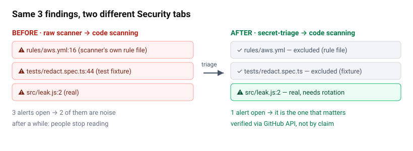

# secret-scan-triage · 密钥扫描误报分诊（原先叫 ai-code-health）



**你的扫描器说"发现 3 个泄露"，其实只有 1 个是真的。** 这个工具把噪声摘掉——只在真的需要轮换凭据时才让你红。

```bash
node review.mjs <你的仓库> --from-report 你的报告.json
```

已验证：3 条输入 → GitHub 代码扫描里只进 **1 条**告警（[可自己查 API](https://github.com/zjdyzww/secret-triage-demo)）。

技术说明：[为什么"更严的正则"救不了你的密钥扫描](WHY-CONTEXT-BEATS-REGEX.md)（含两组实测数据与复现命令）。

**你会拿到什么**：[真实样例报告](SAMPLE-REPORT.md)（真实仓库、真实输入输出、可自行复核）。


 > 三分钟出报告：**扫描器报的这些告警，哪几条是真的。**
> 全程本地运行，不上传一行代码。

**为什么改名**：GitHub 上 "code health" 已被更成熟的项目占住（如 repowise ★8k），
而这个仓库真正做的事只有一件——**对密钥扫描结果做语境分诊**，把误报摘出来。名字应该诚实反映这件小事。

## 它解决什么问题

大多数"安全扫描"报告的问题是：**喊狼来了**。
一个 4 万文件的仓库，粗暴扫描会报出 28 处"密钥泄露"——其中 18 处是测试夹具里的假密钥、
3 处是扫描器自己的规则、2 处是文档模板、1 处是构建产物、3 处是文档快照。**真泄露 0 处。**

`ai-code-health` 的价值就在这句 **"0 处"** —— 它把每个候选命中**分诊**到 6 个类别并给出依据，
让你不用花 3 小时逐条确认"这是不是真的"。

## 怎么用

```bash
node review.mjs /path/to/your/repo                 # 打印 Markdown 报告
node review.mjs /path/to/your/repo --out r.md      # 写入文件
node review.mjs /path/to/your/repo --json          # 机器可读（供 CI 用）
node review.mjs /path/to/your/repo --timeout 300    # 测试/构建超时（默认 180s）
```

退出码：`0` 无高危 · `1` 有高危 · `2` 用法错误 · `3` 目标不可读 —— 可直接挂进 CI。


## 模式二：分诊**已有扫描器**的输出（推荐用法）

> 定位修正（2026-11-24 普查后）：我的 6 类强特征太窄——在 10 个主流通用库（2242 文件）上只有 2 条候选。
> **所以我不该假装替代你的扫描器；我的价值在判定层。**

```bash
node review.mjs <你的仓库> --from-report gitleaks-report.json
```

支持三种输入格式：
| 格式 | 例子 |
|---|---|
| gitleaks JSON | `[{"File":"rules/aws.yml","StartLine":16,"RuleID":"aws-access-token"}]` |
| TruffleHog JSON | `[{"DetectorName":"AWS","SourceMetadata":{"Data":{"Filesystem":{"file":"rules/aws.yml","line":16}}}}]` |
| SARIF | `{"runs":[{"results":[{"locations":[{"physicalLocation":{"artifactLocation":{"uri":"..."},...}}]}]}]}` |
| 任意含 `路径:行号` 的文本 | `rules/aws.yml:16:1 aws-access-token` |

**实测**（5 条输入的 gitleaks 风格报告）：
```
输入候选 5 条 → 真需处理 1 条（src/leak-real.js:2），其余 4 条：
  测试夹具 2：tests/redact.spec.ts:44、docs/example-env.md:5
  扫描规则文件 2：rules/aws.yml:16、rules/github.yml:13
```
退出码：`0` 全部被排除 / `1` 有真需处理 / `3` 报告不可读或无条目。

## 四项检查

| 检查 | 内容 | 输出 |
|---|---|---|
| 密钥泄露 | 6 类强特征正则（AWS/GitHub/OpenAI/Slack/私钥块/Google） + 弱特征提示 | 真高危列表 + 6 类分诊表 |
| 依赖可复现性 | 浮动版本、安装期钩子、锁定文件缺失 | 风险条目 |
| 测试 | 自动探测 `npm test`，带超时 | pass / fail / absent / timeout |
| 构建 | 自动探测 `npm run build`，带超时 | pass / fail / absent / timeout |

**测不了的一律写 `UNVERIFIED`**，绝不当成"通过"。

## 分诊规则（可审计，不是黑盒）

| 类别 | 判定依据 |
|---|---|
| 测试夹具/示例 | 路径含 `tests/`、`__tests__`、`fixtures/`、`*.spec.*`、`*_test.go`；或命中行含 `fake/dummy/example/redact` |
| 扫描规则/基线 | 文件名含 `gitleaks.toml`、`.gitleaks`、`detect-secrets`、`secrets-baseline` |
| 文档/模板 | `.md/.mdx/.txt` 或路径含 `/docs/` |
| 构建产物 | 路径含 `lib/ dist/ build/ chunks/ vendor/` 或 `*.min.js` |
| 检测器自身 | 文件名含 `verify-*secret*`、`*secret-scan*` 等 |
| 数据/知识库快照 | `.json/.ndjson` 且路径含 `store/snapshot/corpus/knowledge` |

## 真实样例（本机实测，4.3 万文件仓库）

```
扫描文件：42986
候选命中：28
真高危：  0
分诊：测试夹具 18 · 规则文件 1 · 文档 2 · 构建产物 1 · 检测器 3 · 知识库快照 3
依赖问题：2（浮动版本 1、缺锁定文件 1）
用时：约 3 分钟
```

## 收费（三种）

| 档 | 交付 | 价格 |
|---|---|---|
| 体检报告 | 本工具报告 + 我人工复核 6 类分诊 + 一页行动清单 | ¥199 |
| 体检 + 修复 | 上述 + 修掉"可修项"（依赖锁定、构建/测试红、真泄露轮换指引） | ¥899 起 |
| 月度监控 | 每周自动跑 + 报告 + 变动告警 | ¥399/月 |

## 边界（先说不做的）

- 不做渗透测试、不做合规认证（等保/SOC2 需持牌机构）
- 不覆盖非 Node 生态的测试/构建探测（会写 `absent`，不猜）
- 报告只覆盖"本机能跑到的部分"；外部依赖缺失记 `UNVERIFIED`

## 直接用 GitHub Action（无需安装）

```yaml
- name: Triage it
  uses: zjdyzww/secret-triage-action@v1
  with:
    report: gitleaks.json      # 你自己的扫描器输出
    fail-on-real: 'true'       # 只在真有问题时让构建红
```

输出 `real` / `triaged` 两个值，并把摘要写进 Job Summary。
该 Action 已在本仓库的真 runner 上跑通（见 `.github/workflows/self-test-action.yml`）。

## 支持哪些扫描器（3 秒判断能不能用）

| 你用的扫描器 | 怎么接 |
|---|---|
| **gitleaks** | `gitleaks detect --report-format json --report-path gitleaks.json` → `--from-report gitleaks.json` |
| **TruffleHog** | `trufflehog filesystem . --json > th.json` → `--from-report th.json` |
| **Semgrep / 任意 SARIF 工具** | 直接喂 SARIF 文件 |
| **GitHub 原生 secret scanning** | `gh api /repos/{o}/{r}/secret-scanning/alerts > alerts.json` → `--from-report alerts.json` |
| **自研 / grep / git-hound** | 任何含 `路径:行号` 的文本 |

```bash
# 例：GitHub 自家告警（最吵的那种）
gh api /repos/OWNER/REPO/secret-scanning/alerts > alerts.json
node review.mjs . --from-report alerts.json
```

> 诚实标注：GitHub 告警格式按**官方 schema** 实现并用人工构造样本测过（2 条输入 → 1 真 1 排除）；
> 但**尚未用真实导出验证**——我账号下公开仓库的 `secret-scanning/alerts` 导出为 `[]`，无法取得真实样本。
```

## 想让我替你做（可选）

**先自己跑**：`node review.mjs <你的仓库> --from-report 你的报告.json` —— 免费、2 分钟、不用联系任何人。

如果你希望有人**逐条给出判定理由**（谁看都认的那种），开一个 issue 用「申请一次密钥告警分诊」模板：
贴 3–5 条示例（路径:行号），**我先免费给这几条判定**，你判断值不值得继续。

- 我不会主动到别的仓库推销，也不会群发。
- 这个入口是我唯一接受委托的地方——公开、留痕、可核对。
- 别贴真实凭据：报告里含完整密钥值时，先替换成前 6 位 + `***`。
